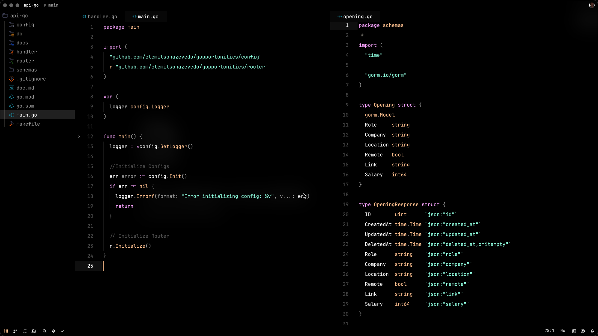
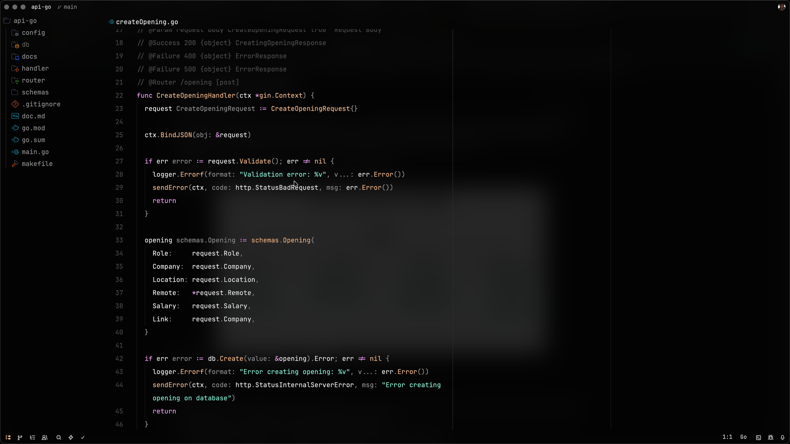

# Palanca Theme

A dark theme for Zed and Obsidian, inspired by [Vesper](https://github.com/raunofreiberg/vesper).

## Zed Screenshots





### Instalação

O Palanca pode ser instalado de duas maneiras:

**1. Dev Extension (Recomendado)**

1. Clone o repositório:

   ```bash
   git clone https://github.com/clemilsonazevedo/palanca-theme.git
   ```

2. Abra o Zed e execute `zed: install dev extension` na paleta de comandos (`Cmd + Shift + P` / `Ctrl + Shift + P`).
3. Selecione a pasta do projeto que contém o ficheiro `extension.toml`.
4. Após a instalação, abra o seletor de temas (`Cmd + K`, depois `Cmd + T` no macOS ou `Ctrl + K`, depois `Ctrl + T` no Windows/Linux).
5. Selecione **Palanca**.

> Requer Rust instalado através do [rustup](https://rustup.rs/).

**2. Instalação manual**

Copie o ficheiro JSON do tema para a pasta local de temas do Zed.

| Sistema | Diretório |
|---|---|
| macOS / Linux | `~/.config/zed/themes/` |
| Windows | `%USERPROFILE%\AppData\Roaming\Zed\themes\` |

No macOS/Linux, pode criar a pasta com:

```bash
mkdir -p ~/.config/zed/themes
```

Coloque o ficheiro `palanca.json` dentro da pasta `themes/`, reinicie o Zed e selecione **Palanca** no seletor de temas.

---

## Obsidian

A versão para Obsidian mantém o fundo preto e a paleta do Palanca: turquesa nos destaques, pêssego nas strings e citações, e rosa nas palavras-chave do código.

### Instalação manual

1. Abra a pasta do seu cofre (*Vault*) no gerenciador de arquivos.
2. Habilite a visualização de ficheiros ocultos:
   - Windows: `Ctrl + Shift + .`
   - macOS: `Cmd + Shift + .`
   - Linux: `Ctrl + H`
3. Dentro de `.obsidian/themes/`, crie uma pasta chamada `Palanca`.
4. Copie os ficheiros `theme.css` e `manifest.json`, disponíveis em `themes/obsidian/` neste repositório, para a pasta criada.

A estrutura deverá ficar assim:

```text
Seu cofre/
└── .obsidian/
    └── themes/
        └── Palanca/
            ├── manifest.json
            └── theme.css
```

5. No Obsidian, aceda a **Configurações → Aparência**, selecione o esquema **Escuro** e escolha **Palanca** em **Temas**.

> Se não aparecer, reinicie o Obsidian. Se utilizar uma pasta de configuração personalizada, substitua `.obsidian` pelo nome dessa pasta.

### Transparência

Desenvolvido para o modo escuro, com suporte parcial à transparência. Os fundos principais do editor e das barras laterais permanecem opacos.
